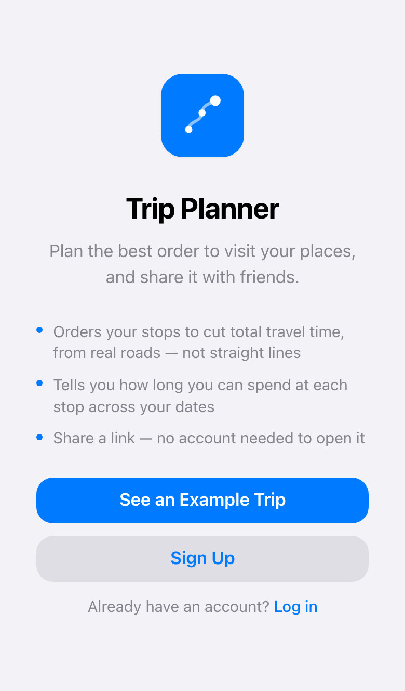
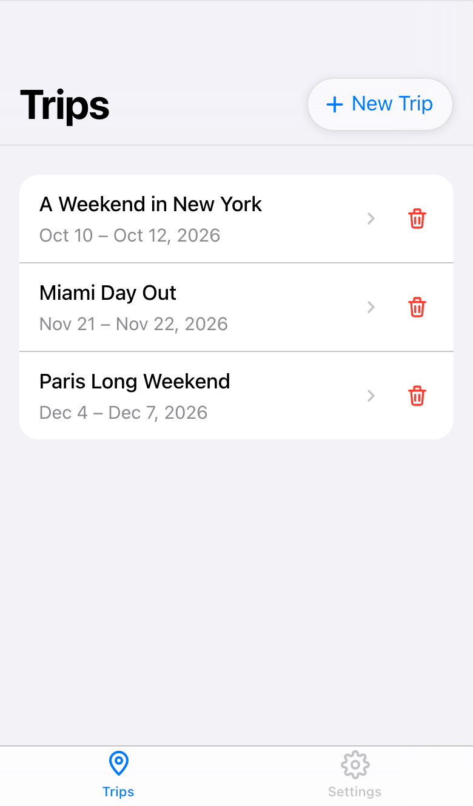
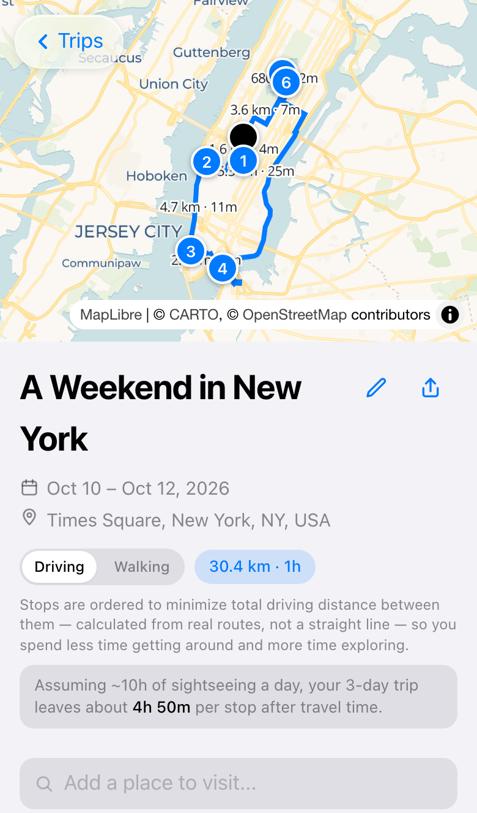
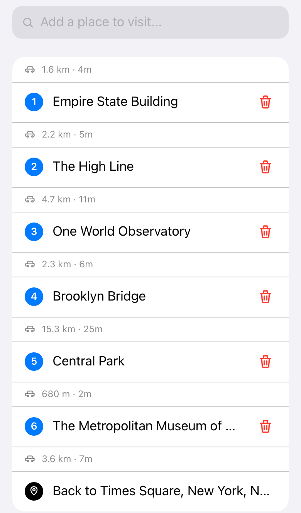
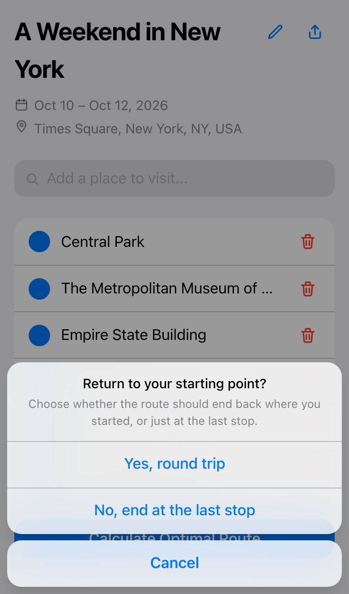
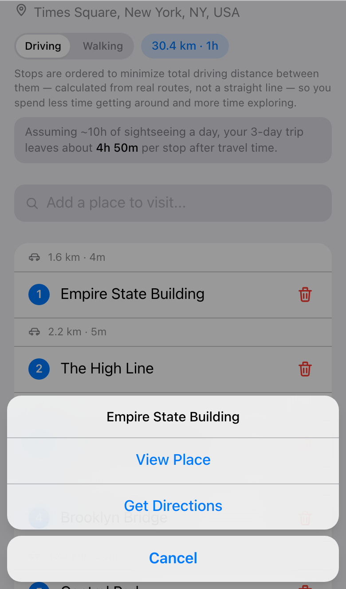
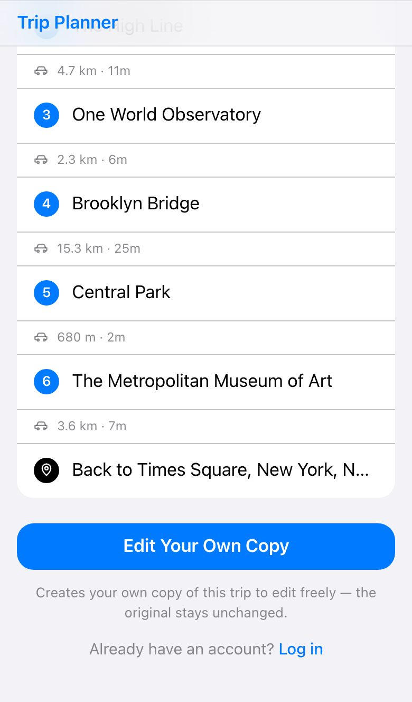
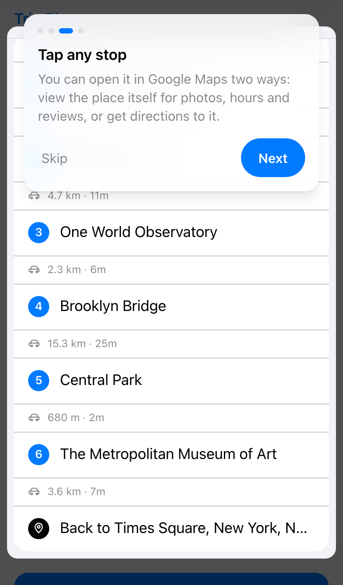
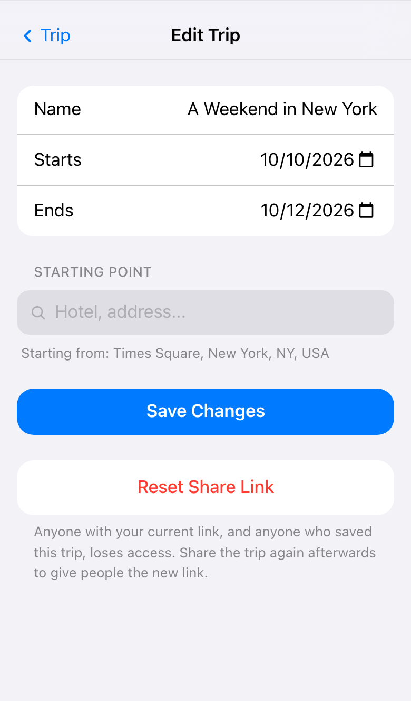
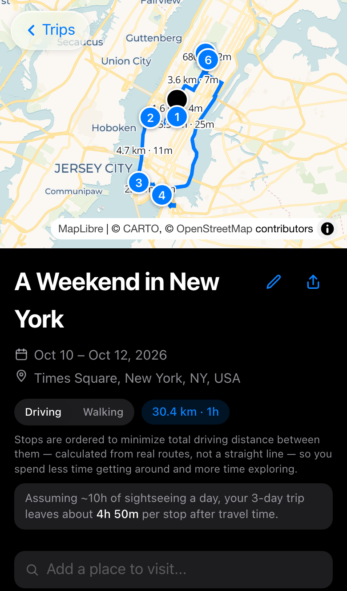

# Trip Planner

Plan the best order to visit a list of places, see the real driving and walking time between each
stop, and share the trip with a link. A mobile-first PWA built to feel like a native iOS app.

- **Optimal ordering** — stops are sequenced to minimise total travel time using real road
  networks (not straight lines), as a round trip back to the start or a one-way route.
- **Driving and walking** — both are calculated together and toggled in the UI, with per-leg
  distance and time on the map and in the list.
- **Time per stop** — given the trip's dates and the travel time, estimates how long you can spend
  at each stop.
- **Add stops by search or by pasted Google Maps link** — including links shared from the Google
  Maps phone app.
- **Share by link** — anyone can open a shared trip without an account, see the map and route, and
  open any stop in Google Maps. They can make their own editable copy; the original is untouched.
  The owner can reset the link at any time.

## Screenshots

Mobile-first, shown at iPhone size (390 pt wide) with sample trips.

<table>
  <tr>
    <td align="center" valign="top">
      <br>
      <sub><b>Landing</b><br>See an example without signing up</sub>
    </td>
    <td align="center" valign="top">
      <br>
      <sub><b>Your trips</b></sub>
    </td>
    <td align="center" valign="top">
      <br>
      <sub><b>The route</b><br>Real roads, with time per stop</sub>
    </td>
    <td align="center" valign="top">
      <br>
      <sub><b>Stops in order</b><br>Distance between each</sub>
    </td>
  </tr>
  <tr>
    <td align="center" valign="top">
      <br>
      <sub><b>Round trip or one-way</b></sub>
    </td>
    <td align="center" valign="top">
      <br>
      <sub><b>Open a stop</b><br>View place or directions</sub>
    </td>
    <td align="center" valign="top">
      <br>
      <sub><b>Shared trip</b><br>No account needed to open</sub>
    </td>
    <td align="center" valign="top">
      <br>
      <sub><b>First-visit tour</b></sub>
    </td>
  </tr>
  <tr>
    <td align="center" valign="top">
      <br>
      <sub><b>Edit &amp; reset link</b></sub>
    </td>
    <td align="center" valign="top">
      <br>
      <sub><b>Dark mode</b></sub>
    </td>
    <td></td>
    <td></td>
  </tr>
</table>

## Stack

Next.js 14 (App Router, Server Actions) · TypeScript · Tailwind CSS · Supabase (Auth, Postgres, Row
Level Security) · MapLibre GL with the free CARTO Voyager basemap · HeiGIT / OpenRouteService
(VROOM optimisation, Directions, Pelias geocoding) · Vercel.

## Running it yourself

You need Node.js 18.17 or newer, a Supabase project, and an OpenRouteService API key (free, email
signup only, no card).

1. **Install**

   ```bash
   npm install
   cp .env.example .env.local
   ```

2. **Fill in `.env.local`** — see [`.env.example`](.env.example) for what each value is.
   - Supabase: Project Settings → API Keys (`anon key`, `service_role key`) and Integrations →
     Data API (`Project URL`).
   - OpenRouteService: sign up at openrouteservice.org/dev/#/signup → Dashboard → API key.

3. **Create the database.** Run the files in [`supabase/migrations`](supabase/migrations) in order
   (`0001` → `0004`) in the Supabase SQL editor, or with `supabase db push`. **Don't skip the later
   ones**: without them signup, viewing shared trips and the share feature itself are broken.

4. **Configure Supabase Auth** (Authentication → URL Configuration): set the Site URL to your
   deployment and add `<your-url>/auth/callback` to the redirect URLs. Google sign-in is optional
   and is enabled under Authentication → Providers.

5. **Run**

   ```bash
   npm run dev
   ```

`npm run dev` and `npm run build` first copy MapLibre's worker file into `public/maplibre/` (see
[`scripts/copy-maplibre-worker.mjs`](scripts/copy-maplibre-worker.mjs) for why). That directory is
generated and git-ignored.

### Optional: a landing-page example trip

If `NEXT_PUBLIC_DEMO_TRIP_ID` and `NEXT_PUBLIC_DEMO_TRIP_TOKEN` are both set, the landing page shows
a "See an Example Trip" button that opens that trip's public share view. Leave them unset to hide
the button.

## Project structure

```
src/
  app/            Routes (App Router): (auth), auth/ (OAuth + email callback), trips, settings, api
  components/     UI by domain: map/, trip/, ui/, auth/, settings/
  lib/            Supabase clients, OpenRouteService calls, shared helpers
  hooks/          React hooks (geolocation)
  types/          Shared types (Trip, Stop, TripMember)
supabase/
  migrations/     SQL schema + Row Level Security policies
scripts/          Build-time helpers
```

## Security model

Worth reading before you deploy your own, or if you're auditing this one.

- **Row Level Security is the access control.** Every table has RLS enabled; the policies live in
  the migrations. The app talks to the database as the signed-in user, so a bug in application
  code can't read another user's trips.
- **The service-role key bypasses RLS and is server-only.** It is used in three files
  (share-link lookups and copies, and account deletion), and each validates a share token or the
  caller's own identity first. Never give it a `NEXT_PUBLIC_` prefix.
- **A share link is a bearer secret.** Anyone holding it can view that trip. It carries a random
  UUID that is not guessable, and the owner can rotate it from the trip's edit screen, which also
  removes everyone who had saved the trip.
- **The search and link-parsing endpoints require a session**, because they spend a shared
  third-party quota. The link parser also only follows redirects between Google-owned hosts.
- **A Content Security Policy and the usual security headers** are set in
  [`next.config.js`](next.config.js). Scripts still allow `'unsafe-inline'` (Next.js bootstrap
  scripts); the policy's value is in restricting framing, plugins and where requests may go.

Found a vulnerability? Please open a private security advisory on this repository rather than a
public issue.

## License

[MIT](LICENSE)
